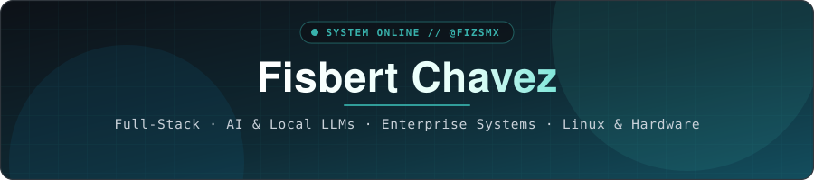

<div align="center">
  

  <a href="https://github.com/fizsmx">
    
  </a>

  <p>
    <a href="https://fizsmx.github.io"></a>
    <a href="mailto:fisbert.smx@gmail.com"></a>
    <a href="https://instagram.com/dean_smx"></a>
    <!-- Uncomment and update once your LinkedIn URL is ready:
    <a href="https://linkedin.com/in/YOUR-HANDLE"></a>
    -->
    
    
  </p>
</div>

---

### `>_ whoami`

```yaml
engineer:    Fisbert Chavez (@fizsmx)
focus:       Full-Stack Engineering · Applied AI & Local LLMs · Enterprise Systems · Linux & Hardware
approach:    End-to-End Execution — from bare-metal hardware & networks to containerized cloud production
mindset:     Clean Architecture, pragmatic automation, security-first engineering, zero fluff
```

I am a **multidisciplinary software engineer and technology specialist** who operates across the full computing spectrum. Whether I am architecting **TypeScript/Next.js web platforms**, deploying **offline & cloud AI/LLM agents**, customizing **Odoo ERP and payment/ticketing systems**, configuring **Linux servers, Docker/Traefik stacks, and network telemetry**, or troubleshooting **hardware and IT infrastructure**, I focus on shipping reliable, scalable, real-world systems.

---

### Core Engineering Domains

<table>
  <tr>
    <td width="50%" valign="top">
      <h4>Full-Stack &amp; Web Architecture</h4>
      Production web applications built with <strong>TypeScript, Next.js, React, Node.js, Python (FastAPI), PHP</strong>, and relational databases (<strong>PostgreSQL, Supabase, MariaDB, Prisma</strong>), structured with Clean Architecture and automated testing.
    </td>
    <td width="50%" valign="top">
      <h4>Applied AI, LLMs &amp; Automation</h4>
      Local &amp; cloud AI engineering using <strong>llama.cpp (GGUF / Vulkan), Google Gemini, Claude, Ollama, and LangChain</strong> — from offline competitive-coding solvers and legal/document analysis pipelines to browser &amp; workflow automation.
    </td>
  </tr>
  <tr>
    <td width="50%" valign="top">
      <h4>Enterprise, Fintech &amp; CMS</h4>
      Custom <strong>Odoo ERP</strong> modules &amp; SaaS tooling, Bolivian payment gateway integrations, HMAC-signed QR ticketing systems, custom <strong>WordPress</strong> block themes/plugins, and territorial/cadastre management platforms.
    </td>
    <td width="50%" valign="top">
      <h4>Linux, Networking &amp; Hardware</h4>
      Daily <strong>Linux</strong> power user &amp; sysadmin (Arch, Debian, Ubuntu, Kali), <strong>Docker + Traefik</strong> production hosting, router traffic monitoring, network diagnostics, virtualization, cybersecurity tooling, and PC/server hardware infrastructure.
    </td>
  </tr>
</table>

---

### Featured Public Projects

| Project | Description | Core Stack | Links |
| :--- | :--- | :--- | :--- |
| **[CodeSolver Offline](https://github.com/fizsmx/ACM_program)** | Portable, 100% offline competitive programming AI assistant powered by local LLMs (`llama.cpp` + GGUF Vulkan/CPU) with automated test verification & self-repair loops. | `Python` `llama.cpp` `Local LLM` `JS` | [Repo](https://github.com/fizsmx/ACM_program) |
| **[The Metiendole](https://github.com/fizsmx/the_metiendole)** | Full-stack streaming community hub with NextAuth v5 roles, XP/levels, daily streaks, polls, giveaways, and a live transparent **OBS roulette overlay**. | `Next.js 16` `TypeScript` `Prisma` `Docker` | [Repo](https://github.com/fizsmx/the_metiendole) · [Live Demo](https://the-metiendole.vercel.app) |
| **[30 Días para Reconectar](https://github.com/fizsmx/Libro)** | Interactive 30-day couples reflection **PWA** with private partner workspaces, invite pairing, single-use access codes, and **Google Gemini AI** daily insights. | `Next.js` `Supabase` `Gemini AI` `PWA` | [Repo](https://github.com/fizsmx/Libro) · [Live Demo](https://libro-rust.vercel.app) |
| **[FAST PASSANT](https://github.com/fizsmx/fast-passant)** | University internship management platform architected under **Clean Architecture** (`domain`, `use-cases`, `infrastructure`, `presentation`) with unit tests. | `React 18` `TypeScript` `Tailwind` `Vitest` | [Repo](https://github.com/fizsmx/fast-passant) |
| **[MetResp](https://github.com/fizsmx/MetResp)** | Interactive Numerical Methods web suite & scientific calculator delivering full step-by-step analytical derivations for engineering & mathematics. | `HTML5` `JavaScript` `Scientific Computing` | [Repo](https://github.com/fizsmx/MetResp) · [Live Demo](https://fizsmx.github.io/MetResp/) |
| **[Gestión Urbana](https://github.com/fizsmx/gestion-urbana)** | Civic-tech portal for citizen urban issue reporting and municipal status tracking, containerized with MariaDB healthchecks and Traefik HTTPS. | `PHP 8.3` `MariaDB` `Docker` `Traefik` | [Repo](https://github.com/fizsmx/gestion-urbana) · [Preview](https://fizsmx.github.io/gestion-urbana/) |

> **Private & Production Engineering:** Beyond public repositories, I actively architect and maintain private commercial systems spanning **AI-powered Bolivian legal contract analysis**, **municipal cadastre & GIS platforms**, **Odoo ERP SaaS & AI agents**, **local payment gateways**, **QR event ticketing plugins**, and **real-time router/network traffic dashboards**.

---

### Tech Stack & Toolbox

<div align="center">
  <p><strong>Programming Languages &amp; Scripting</strong></p>
  

  <p><strong>Frontend, UI, Mobile &amp; Creative Design</strong></p>
  

  <p><strong>Backend, Frameworks, APIs &amp; Databases</strong></p>
  

  <p><strong>Cloud, DevOps, Linux, OS &amp; Developer Environments</strong></p>
  

  <p><strong>AI / Machine Learning, Embedded Hardware, CI/CD &amp; Observability</strong></p>
  

  <p><strong>LLMs &amp; AI Agents · Enterprise ERP · Cybersecurity, Networking &amp; Hardware</strong></p>
  <p>
    
    
    
    
    
    
    
    
    
    
  </p>
  <p>
    
    
    
    
    
    
    
    
    
    
    
  </p>
  <p>
    
    
    
    
    
    
    
    
    
    
    
    
    
  </p>
</div>

---

### GitHub Telemetry & Activity

<div align="center">
  <picture>
    <source media="(prefers-color-scheme: dark)" srcset="https://raw.githubusercontent.com/fizsmx/fizsmx/output/github-contribution-grid-snake-dark.svg" />
    <source media="(prefers-color-scheme: light)" srcset="https://raw.githubusercontent.com/fizsmx/fizsmx/output/github-contribution-grid-snake.svg" />
    
  </picture>
  <br /><br />
  
  &nbsp;
  
  <br /><br />
  
</div>

---

### `>_ System Access Granted...`

<div align="center">
  
</div>


